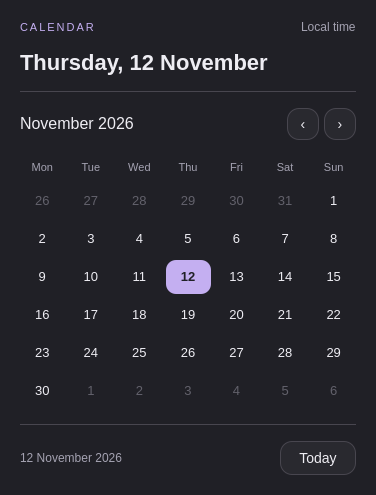

# Velunori Clock

An independent Omarchy clock and calendar using the **Velunori core design kit
v1**. Requires `velunori.core` **0.2.0 or later**, installed alongside this plugin.



The bar shows the local time and an optional date. Click the clock to open the
calendar. Browse months with the chevrons or Left/Right keys, select a day, and
use Today (or Home) to return to the current date. Escape and outside clicks
dismiss the panel. Weekday and month labels follow the system locale; the first
day of the week defaults to the locale as well. This is a calendar view, without
event or reminder storage.

## Local installation

With the repositories at `~/dev/Velunori/core` and `~/dev/Velunori/clock`:

```bash
cd ~/dev/Velunori/clock
bash scripts/check.sh
bash scripts/install-local.sh
omarchy restart shell
```

The installer verifies core, backs up `shell.json`, links this checkout to
`~/.config/omarchy/plugins/velunori.clock`, and replaces `omarchy.clock` in its
existing section and position. Other widgets remain in place. If the built-in
clock is absent, it adds Velunori Clock to the center. Core itself stays
independent of the clock.

To return to the built-in clock:

```bash
omarchy plugin enable omarchy.clock --section center --before velunori.clock
omarchy plugin disable velunori.clock
```

## Configuration

Inline widget settings in `bar.layout`:

```json
{
  "id": "velunori.clock",
  "timeFormat": "HH:mm",
  "dateFormat": "ddd, d MMM",
  "showDate": true,
  "weekStartDay": 1
}
```

`weekStartDay`: 0 or 7 = Sunday, 1 = Monday, through 6 = Saturday. Omit it to
follow the system locale. Qt date/time format strings are supported; including
seconds in `timeFormat` increases the update precision to seconds. Timezone is
the machine's local timezone.

The plugin inherits accent and animation settings from core, including live
appearance previews. It renders with the default Velunori palette if core is
installed but a different bar is active.

## Checks and limits

Tests cover month grids, leap years, year boundaries, DST, month selection,
Today, and live theme propagation. QML lint covers the widget and shared kit.
The headless calendar UI is rendered for inspection. The live Wayland layer
panel, click routing, multi-monitor behavior and IPC still need a desktop check.
The sandbox may report an IPC-socket error during the headless check.

The shared kit is imported from the sibling installation path
`../velunori.core/kit`; installation under the manifest IDs is required. Set
`VELUNORI_CORE_PATH` when running checks against a differently located checkout.

The local core installer prepares a sibling manifest-ID alias for development
symlinks. Public components have explicit `qmldir` declarations. Check both
installation modes with `VELUNORI_TEST_LAYOUT=copy` and `symlink`; use
`VELUNORI_TEST_STARTS=3` for repeated cold starts. See core's
[stability investigation](https://github.com/velunori/core/blob/main/docs/stability.md) for the known host race.

Run `bash scripts/check-session.sh --restart` from the desktop terminal to
verify actual clock geometry and calendar open/close behavior. It checks for
new crash reports, including failures masked by automatic shell recovery.
