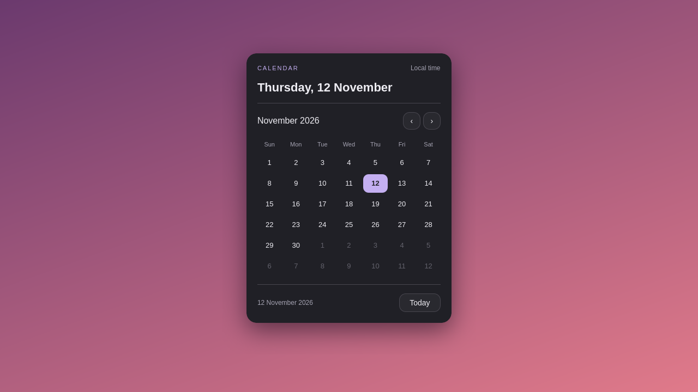

# Velunori Clock

> The time in the bar, and a month calendar one click away.



## Features

- Local time in the bar with an optional date.
- A month calendar: browse with the chevrons or Left/Right, pick a day, return with Today or Home. Escape or a click outside closes it.
- Weekday and month names follow the system locale, as does the first day of the week unless you set it.
- Uses the accent and animation setting from Velunori Appearance, including its live preview.

## Status

The calendar is a view only: it does not show or store events yet. A local event store (`calendar_store.py`, SQLite) and its JSON helper exist as groundwork and are not connected to the panel. Google and iCloud synchronisation is planned and not implemented; the plan and the rules it must follow are in [docs/calendar-sync.md](docs/calendar-sync.md).

## Requirements

[Velunori core](https://github.com/velunori/core) 0.2.0 or later, installed next to this plugin. Developed against **Omarchy 4.0.6-1**.

## Install

```bash
bash ~/dev/Velunori/clock/scripts/install-local.sh
omarchy restart shell
```

The installer checks core, backs up `shell.json`, links this checkout to `~/.config/omarchy/plugins/velunori.clock` and puts the clock where `omarchy.clock` was. Other widgets stay in place.

Return to the built-in clock:

```bash
omarchy plugin enable omarchy.clock --section center --before velunori.clock
omarchy plugin disable velunori.clock
```

## Configuration

Settings sit on the widget's entry in `bar.layout`:

```json
{
  "id": "velunori.clock",
  "timeFormat": "HH:mm",
  "dateFormat": "ddd, d MMM",
  "showDate": true,
  "weekStartDay": 1
}
```

`weekStartDay` is 0 or 7 for Sunday, 1 for Monday, up to 6 for Saturday; leave it out to follow the locale. Formats are Qt date/time strings; adding seconds to `timeFormat` makes the clock tick every second.

## Development

```bash
bash scripts/check.sh
VELUNORI_TEST_LAYOUT=symlink bash scripts/check.sh
```

Tests cover month grids, leap years, year boundaries, daylight saving changes, month selection, Today, live theme changes and the local event store. Set `VELUNORI_CORE_PATH` if core is checked out elsewhere, and `VELUNORI_TEST_STARTS=3` for repeated cold starts.

`bash scripts/check-session.sh --restart`, run from a desktop terminal, checks the real clock geometry and that the calendar opens and closes, and looks for new crash reports.

`bash scripts/setup-deps.sh` creates a private `.venv` with the libraries the planned cloud synchronisation will need. Nothing in the current plugin requires it.

## Velunori plugins

Velunori is a set of independent plugins for the [Omarchy](https://omarchy.org) shell. Install only the ones you want; each lives in its own repository and can be removed without touching the others.

| Plugin | What it is |
| --- | --- |
| [core](https://github.com/velunori/core) | The Island and Orbit bars, the appearance settings and the shared design kit |
| **clock** (this repository) | Clock in the bar with a month calendar |
| [control-center](https://github.com/velunori/control-center) | Sound, displays, network, capture and reminders in one panel |
| [notifications](https://github.com/velunori/notifications) | Notification cards and a session history |
| [menu](https://github.com/velunori/menu) | The Omarchy command menu as a two-pane panel |
| [update](https://github.com/velunori/update) | A window for `omarchy update` with release notes and live progress |
| [weather](https://github.com/velunori/weather) | Weather in the bar with a forecast panel |

## License

MIT, see [LICENSE](LICENSE). 
